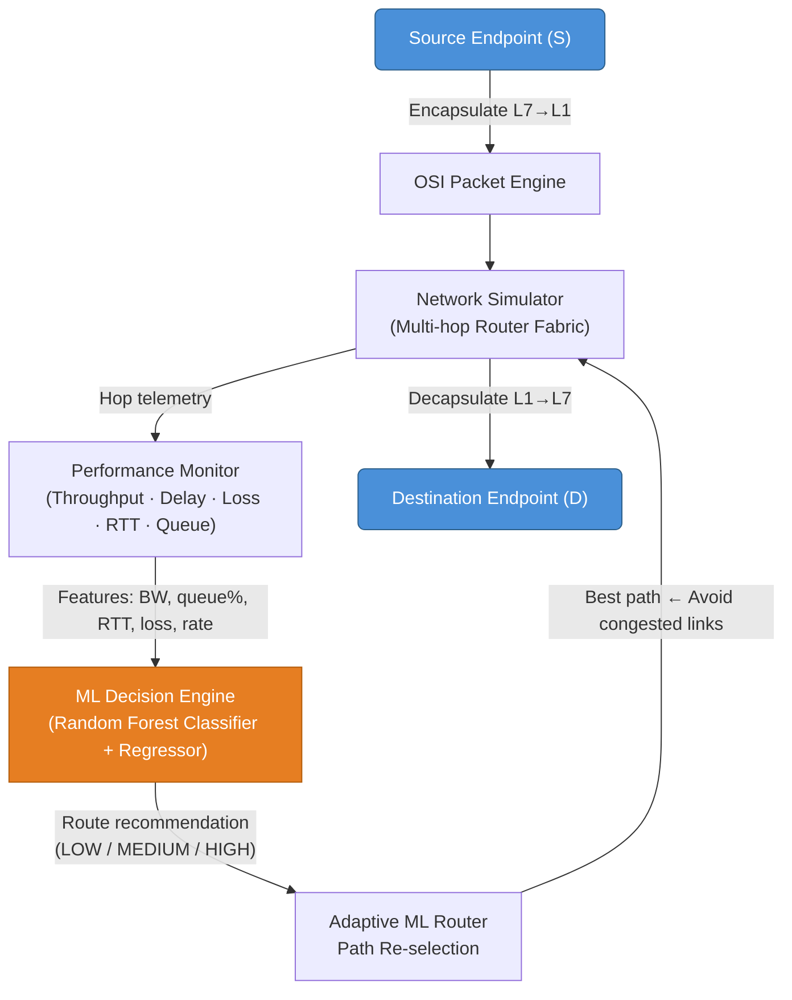
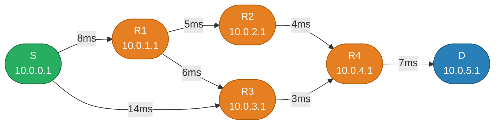
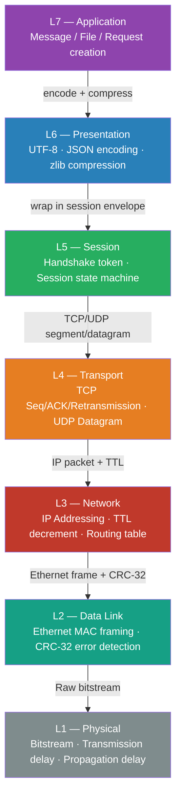
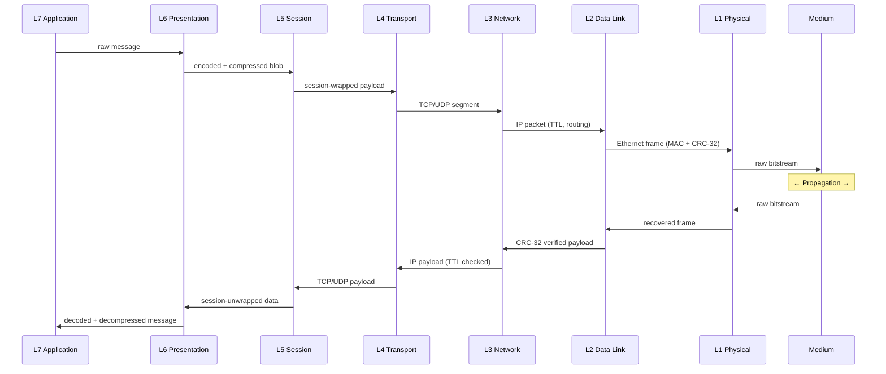
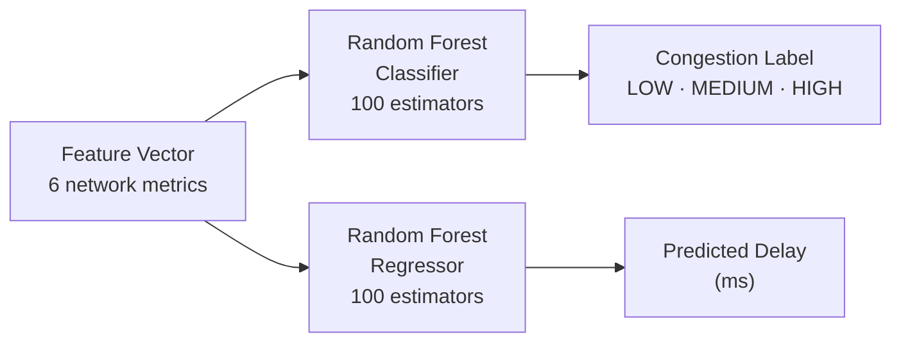
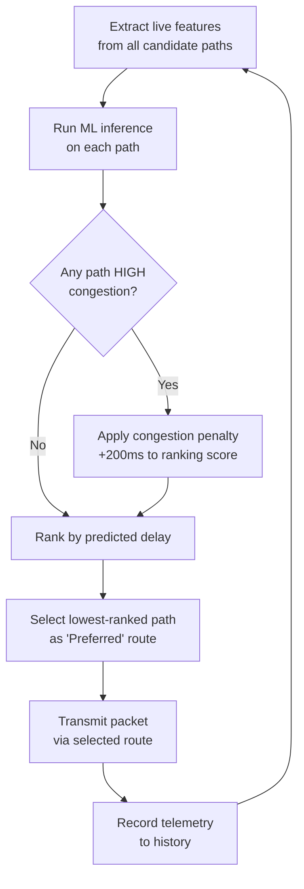
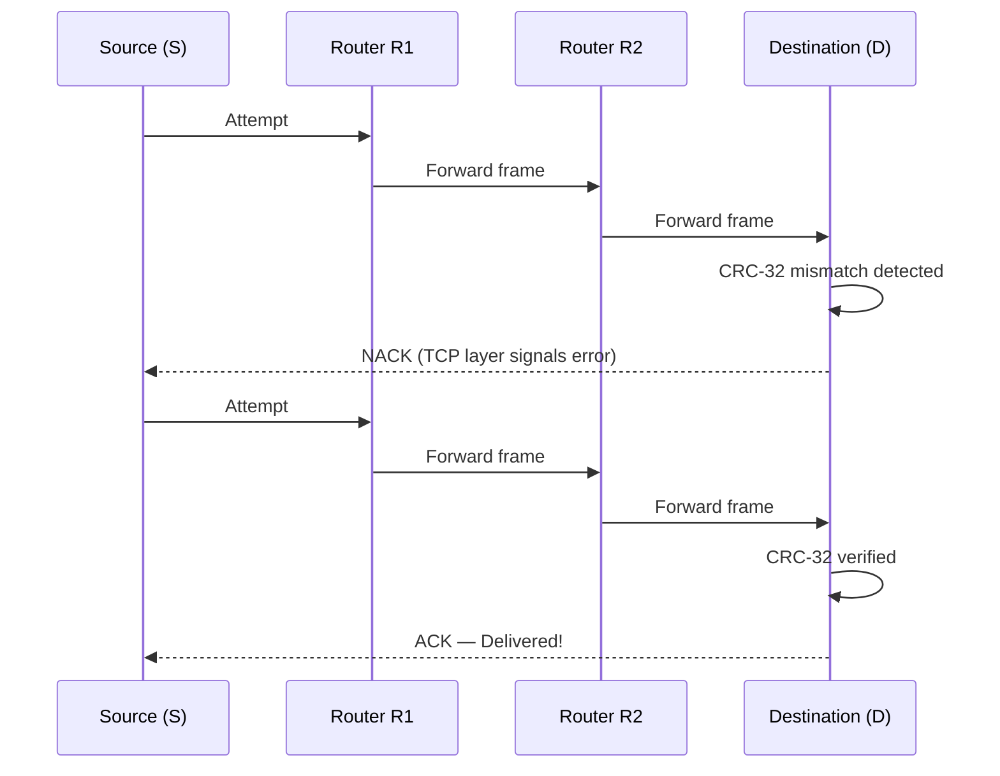
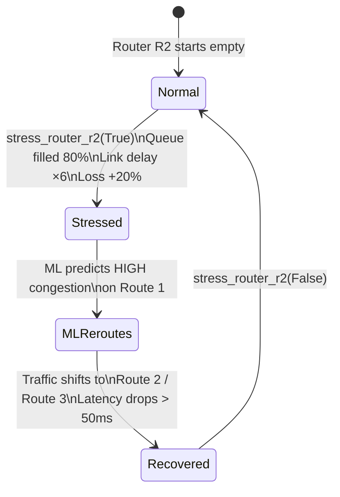
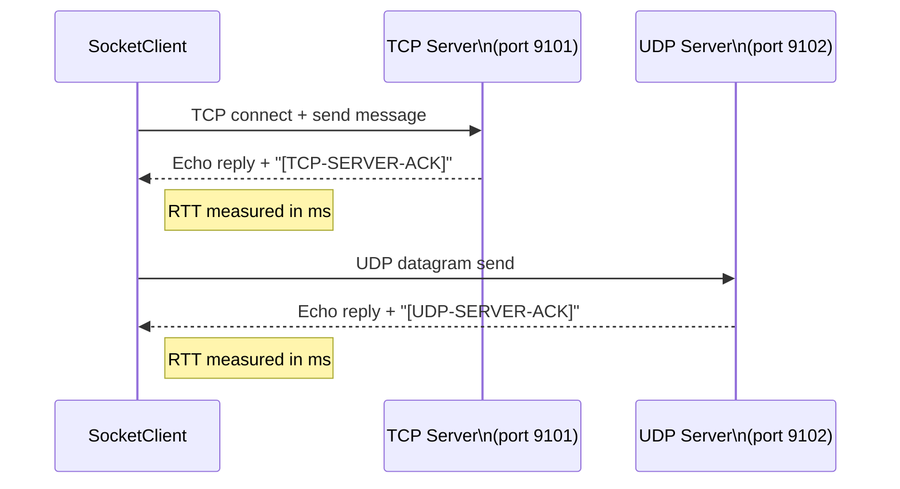
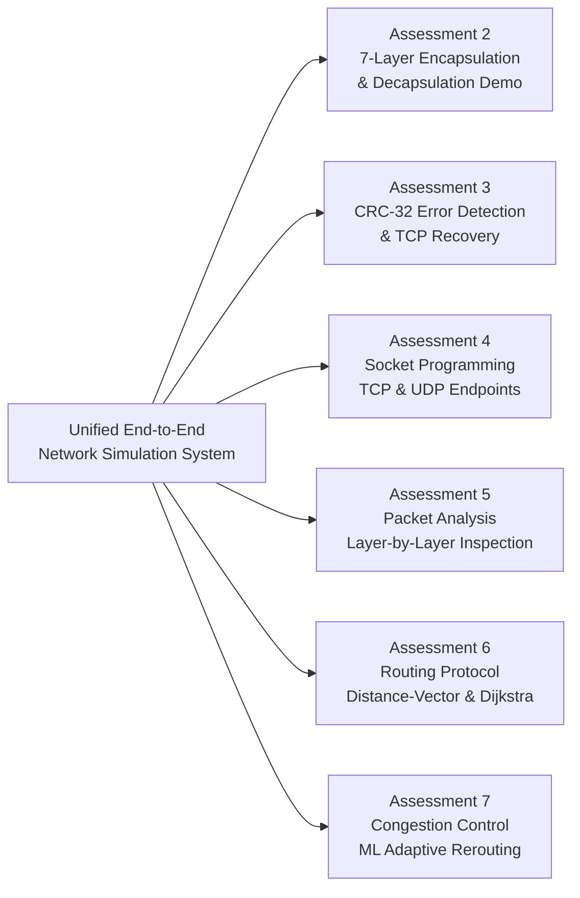

# Adaptive Network Routing & Congestion Control (ML-Enhanced)

> A Python-based end-to-end network simulator that demonstrates all **seven OSI layers** and uses **Machine Learning** to predict congestion and make adaptive routing decisions under changing network conditions.

---

## Project Team

| Name | ID |
|:---|:---|
| Shreejith J | `24BCE0625` |
| Pooja Iykkarath Santhosh | `24BAI0269` |
| Hemal Kamineni | `24BCE0649` |
| Eldo John Giby | `24BCE0387` |
| Anfy Sony | `24BCE2799` |

---

## Table of Contents

1. [Overview](#-overview)
2. [Core Philosophy](#-core-philosophy)
3. [System Architecture](#-system-architecture)
4. [Network Topology](#-network-topology)
5. [Seven-Layer OSI Stack](#-seven-layer-osi-stack)
6. [Machine Learning Engine](#-machine-learning-engine)
7. [Congestion Control & Error Recovery](#-congestion-control--error-recovery)
8. [Socket Programming](#-socket-programming)
9. [Dashboard](#-interactive-dashboard)
10. [Lab Assessment Coverage](#-lab-assessment-coverage)
11. [Directory Structure](#-directory-structure)
12. [Technology Stack](#-technology-stack)
13. [Getting Started](#-getting-started)
14. [Running Tests](#-running-tests)

---

## Overview

This project develops a **Python-first network simulation and analysis system** that demonstrates the complete journey of data across the seven OSI layers while studying routing and congestion under dynamically changing network conditions.

The system:
- Generates application data and encapsulates it through all OSI layers
- Models a software network of configurable routers and links to simulate queuing, packet loss, delay, and link failures
- Trains a **Random Forest ML model** on simulator-generated telemetry to predict congestion and estimate route performance
- Dynamically chooses better paths, reducing latency by **> 50 ms** under congestion
- Presents all results through a **live Streamlit dashboard**

---

## Core Philosophy

```
Generate → Encapsulate → Route → Stress → Predict → Adapt → Deliver → Measure
```

---

## System Architecture

The project separates the seven-layer communication stack from the network-state monitor and the ML control loop.



---

## Network Topology

The simulator builds the **Figure 5** multi-path topology with 4 routers, a source, and a destination:

```
(8ms) (5ms) (4ms)
[S] --------> [R1] ---------> [R2] ---------> [R4] --------> [D] (7ms)
| | ^ ^
| (14ms) | (6ms) | (3ms) |
+-----------> [R3] --------------------------+-------+
```

| Link | Latency | Bandwidth |
|:---|:---:|:---:|
| S → R1 | 8 ms | 10 Mbps |
| S → R3 | 14 ms | 10 Mbps |
| R1 → R2 | 5 ms | 10 Mbps |
| R1 → R3 | 6 ms | 10 Mbps |
| R2 → R4 | 4 ms | 10 Mbps |
| R3 → R4 | 3 ms | 10 Mbps |
| R4 → D | 7 ms | 10 Mbps |

### Candidate Paths (Source → Destination)



| Route | Path | Base Latency |
|:---|:---|:---:|
| **Route 1** | `S → R1 → R2 → R4 → D` | 24 ms |
| **Route 2** | `S → R1 → R3 → R4 → D` | 24 ms |
| **Route 3** | `S → R3 → R4 → D` | 24 ms |

> [!IMPORTANT]
> When Router **R2** is stressed (queue ≥ 80%, latency ×6, packet loss +20%), the ML engine detects **HIGH** congestion on Route 1 and dynamically reroutes traffic to **Route 2 / Route 3**, reducing latency by **> 50 ms** and preventing packet drops.

---

## Seven-Layer OSI Stack

Each layer performs a concrete, inspectable operation in the same end-to-end flow.



### Layer-by-Layer Detail

| Layer | Module | Key Operations |
|:---|:---|:---|
| **L7 Application** | `l7_application.py` | Create messages, file chunks, HTTP-style requests |
| **L6 Presentation** | `l6_presentation.py` | UTF-8 / JSON serialization, optional zlib compression |
| **L5 Session** | `l5_session.py` | Session token handshake, state machine (`OPEN`/`ACTIVE`/`CLOSED`) |
| **L4 Transport** | `l4_transport.py` | TCP Seq/ACK, retransmission on loss; UDP low-latency datagram |
| **L3 Network** | `l3_network.py` | IPv4 packet, TTL decrement at each hop, route history |
| **L2 Data Link** | `l2_datalink.py` | Ethernet MAC framing, **CRC-32** checksum calculation & verification |
| **L1 Physical** | `l1_physical.py` | Bitstream serialization, transmission delay, propagation delay |

### Encapsulation / Decapsulation Flow



---

## Machine Learning Engine

The ML engine is used as a **routing decision component**, not a replacement for networking. It learns from simulator-generated telemetry to predict route quality in real time.

### Feature Vector

| Feature | Description |
|:---|:---|
| `bandwidth_mbps` | Minimum bandwidth along candidate path |
| `packet_rate_pps` | Estimated packets per second (inferred from queue occupancy) |
| `queue_occupancy_pct` | Maximum queue fill % across all routers in path |
| `rtt_ms` | Round-trip time estimate (accumulated link delay × 2) |
| `loss_rate_pct` | Maximum packet loss rate on any link in path |
| `active_connections` | Maximum concurrent connections on any link |

### Models



| Model | Type | Output | Training Data |
|:---|:---|:---|:---|
| **Congestion Classifier** | `RandomForestClassifier` | `LOW` / `MEDIUM` / `HIGH` | 2,000 simulator-generated samples |
| **Delay Regressor** | `RandomForestRegressor` | Predicted latency (ms) | Same 2,000 samples |

### Adaptive Routing Decision Loop



### Example ML Route Decision Under Stress

| Route | ML Congestion State | Predicted Delay | Recommendation |
|:---|:---:|:---:|:---|
| `S → R1 → R2 → R4 → D` | **HIGH** | ~76 ms | Avoid |
| `S → R1 → R3 → R4 → D` | LOW | ~28 ms | **Preferred** |
| `S → R3 → R4 → D` | LOW | ~43 ms | Backup |

---

## Congestion Control & Error Recovery

### CRC-32 Error Detection & TCP Retransmission



### Router Queue Dynamics Under Congestion



### Key Metrics

| Metric | Description |
|:---|:---|
| **Throughput** | Delivered bits per second |
| **End-to-End Delay** | Total latency across all hops |
| **Packet Loss Rate** | Dropped / corrupted packet ratio |
| **Queue Occupancy** | Buffer fill % at each router |
| **RTT** | Round-trip time estimate |
| **Retransmissions** | TCP retransmission count per packet |

---

## Socket Programming

The project includes real **Python TCP and UDP socket endpoints** to verify interoperability with the OSI simulation.



- **TCP Server** (`socket_server.py`): Multi-threaded, echoes back `[TCP-SERVER-ACK]: <message>`
- **UDP Server** (`socket_server.py`): Stateless, echoes back `[UDP-SERVER-ACK]: <message>`
- **Client** (`socket_client.py`): Measures RTT for both protocols

---

## Interactive Dashboard

The Streamlit dashboard provides a fully interactive GUI covering all assessment topics:

| Tab | Content |
|:---|:---|
| ** 7-Layer OSI Inspector** | Encapsulate any message, toggle CRC corruption, inspect per-layer headers as JSON |
| ** Network Topology & ML Routing** | Toggle R2 congestion stress, choose ML vs Static routing, run batch transmissions |
| ** Performance Metrics** | Live latency charts, retransmission bar graphs, and packet telemetry table |
| ** Real Socket Programming** | Send TCP/UDP messages over localhost and view server responses with RTT |

**Launch:**
```bash
streamlit run src/dashboard/app.py
```
Then open **http://localhost:8501** in your browser.

---

## Lab Assessment Coverage



| Assessment | Lab Focus | Implementation Module |
|:---|:---|:---|
| **2** | Demonstration | `OSIStack.encapsulate()` / `decapsulate()` — full 7-layer journey |
| **3** | Error Detection | `DataLinkLayer.inject_bit_error()`, CRC-32 check, TCP retransmission |
| **4** | Socket Programming | `SocketServer` (TCP/UDP), `SocketClient` with RTT |
| **5** | Packet Analysis | `PacketTrace` dataclass — per-layer header JSON inspection |
| **6** | Routing Protocol | `NetworkTopology.dijkstra_shortest_path()`, Distance-Vector path finding |
| **7** | Congestion Control | `AdaptiveMLRouter`, `stress_router_r2()`, ML-driven rerouting |

---

## Directory Structure

```
Computer_Networks/
src/
osi/ # 7-Layer OSI Implementation
l7_application.py # L7: Messages, requests, file chunks
l6_presentation.py # L6: UTF-8, JSON serialization, zlib compression
l5_session.py # L5: Handshake tokens, session state machine
l4_transport.py # L4: TCP Seq/ACK/retransmission, UDP datagram
l3_network.py # L3: IP packet, TTL decrement, routing tables
l2_datalink.py # L2: Ethernet MAC framing, CRC-32 error detection
l1_physical.py # L1: Bitstream serialization, Tx & prop delay
packet_engine.py # Unified 7-layer stack coordinator & packet tracer
network/ # Router & Link Simulation
node.py # RouterNode (queue buffer) & EndpointNode
link.py # NetworkLink: bandwidth, latency & stress injection
topology.py # Figure 5 graph, Dijkstra, candidate paths
simulator.py # Multi-hop engine, telemetry collector
ml/ # Machine Learning Decision Engine
dataset_generator.py # Synthetic telemetry dataset builder
model.py # RandomForest classifier & regressor
controller.py # Closed-loop adaptive routing controller
endpoints/ # Host Socket Programming
socket_server.py # TCP/UDP multi-threaded server
socket_client.py # TCP/UDP client with RTT measurement
dashboard/ # Interactive Web Dashboard
app.py # Streamlit application (4 tabs)
tests/ # Automated Test Suite (17 tests)
test_osi_layers.py # Unit tests: each OSI layer
test_routing_and_ml.py # Tests: topology, router queues, ML models
test_end_to_end.py # Integration tests: delivery & error recovery
run_demo.py # Standalone CLI demonstration (4 stages)
requirements.txt
README.md
```

---

## Technology Stack

| Tool | Role |
|:---|:---|
| **Python 3.9+** | Core simulator, OSI stack, TCP/UDP endpoints |
| **NumPy / Pandas** | Metrics aggregation and ML dataset preparation |
| **scikit-learn** | RandomForest classifier and regressor |
| **Matplotlib** | Performance graphs (latency, retransmissions) |
| **Streamlit** | Interactive live dashboard |
| **pytest** | Automated 17-test suite |
| **Scapy** *(optional)* | Packet construction / independent inspection |
| **Wireshark** *(optional)* | External packet capture verification |
| **Cisco Packet Tracer** *(optional)* | Topology / routing comparison |

---

## Getting Started

### Prerequisites

- Python **3.9 or newer**
- pip

### 1. Install Dependencies

```bash
pip install -r requirements.txt
```

### 2. Run the Unified CLI Demonstration

Executes all 4 demonstration stages showing live encapsulation traces, CRC corruption recovery, ML route adaptation under stress, and socket verification:

```bash
python run_demo.py
```

**Demo Stages:**

| Stage | Description |
|:---|:---|
| **Stage 1** | Seven-layer OSI packet journey & inspection (Assessments 2 & 5) |
| **Stage 2** | CRC error detection & TCP retransmission (Assessment 3) |
| **Stage 3** | Topology stress & ML adaptive routing (Assessments 6 & 7) |
| **Stage 4** | Host socket programming verification (Assessment 4) |

### 3. Launch the Interactive Web Dashboard

```bash
streamlit run src/dashboard/app.py
```

Open **http://localhost:8501** in your browser to:
- Inspect packet headers at every OSI layer
- Toggle router stress and observe ML-driven rerouting
- View live latency and retransmission charts
- Test TCP/UDP socket connections

---

## Running Tests

```bash
pytest tests/
```

The test suite covers **17 automated tests** across:

| Test File | Coverage |
|:---|:---|
| `test_osi_layers.py` | Unit tests for each OSI layer (L1–L7) |
| `test_routing_and_ml.py` | Topology graph, router queue dynamics, ML classifier & regressor |
| `test_end_to_end.py` | Full delivery pipeline, CRC corruption recovery, UDP drop behavior |

```bash
# Verbose output
pytest tests/ -v

# With coverage
pytest tests/ --tb=short
```

---

## One-Line Summary

> **A Python-based network simulator that demonstrates all seven OSI layers and uses machine learning to predict congestion and make adaptive routing decisions under changing network conditions.**

---

*Computer Networks Project — VIT University · 2026*
